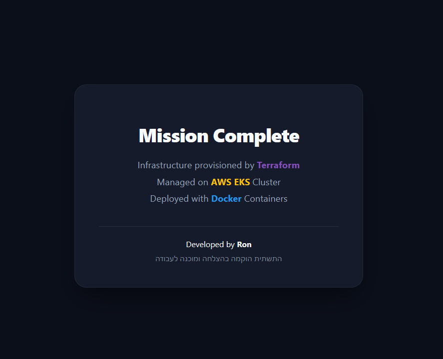
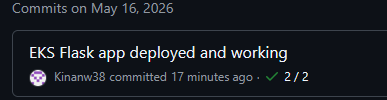
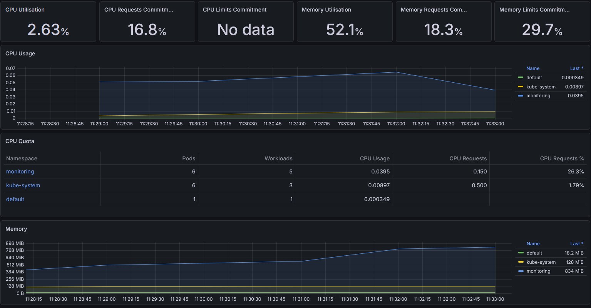

# 🚀 AWS EKS Managed Infrastructure & Flask App

A production-grade DevOps infrastructure: containerized Flask microservice on **Amazon EKS**, infrastructure as code with **Terraform**, deployment with **Helm**, and automation via **GitHub Actions**.

> **Architecture Highlight:** S3 state backend via `bootstrap/` (automated state creation without manual setup) + custom dark-themed Flask UI.

---

## 🛠 Project Architecture

| Layer | Technology | Folder |
|-------|------------|--------|
| State backend | S3 | `bootstrap/` |
| Infrastructure | VPC, NAT, EKS, ECR, IAM | `Terraform/` |
| Application | Flask + Docker | `app/` |
| Orchestration | Helm → LoadBalancer | `flask-chart/` |
| CI/CD | GitHub Actions | `.github/workflows/` |

```
┌─────────────┐     ┌──────────────┐     ┌─────────┐     ┌──────────────┐
│  bootstrap  │ ──► │   Terraform  │ ──► │   ECR   │ ──► │ flask-chart  │
│  (S3 state) │     │ VPC/EKS/ECR  │     │  image  │     │  (Helm/EKS)  │
└─────────────┘     └──────────────┘     └─────────┘     └──────────────┘
                              ▲                                    │
                              │         GitHub Actions             ▼
                              └────────────────────────────────  Internet
```

### 📸 Screenshots

#### Application



#### Automated CI/CD (Terraform Workflow)



#### Cluster Monitoring



---

## 🏗 Tech Stack


---

## 📋 Prerequisites

- AWS account + IAM user for CLI / CI
- [AWS CLI](https://aws.amazon.com/cli/) configured
- [Terraform](https://www.terraform.io/downloads) >= 1.0
- [kubectl](https://kubernetes.io/docs/tasks/tools/)
- [Helm](https://helm.sh/docs/intro/install/)
- [Docker](https://docs.docker.com/get-docker/)

---

## 🚀 Getting Started

| Step | Folder | Before you start | After success |
|------|--------|------------------|---------------|
| 1 | `bootstrap/` | AWS CLI configured | You have `state_bucket_name` |
| 2 | `Terraform/` | Bucket name from step 1 | EKS + ECR exist (~15 min) |
| 3 | `app/` | ECR URL from step 2 | Image pushed to ECR |
| 4 | `flask-chart/` | Image in ECR, kubeconfig set | App URL in browser |
| 5 | GitHub | Secrets configured | CI can build & deploy |

---

### 1️⃣ Backend Bootstrapping

**Working directory:** `bootstrap/`

```bash
terraform init
terraform apply
```

Copy output `state_bucket_name` (e.g. `ron-devops-state-a1b2c3d4`).

> Configured to utilize S3 for remote state management.

---

### 2️⃣ Infrastructure Provisioning (Terraform)

**Working directory:** `Terraform/`

```bash
terraform init -backend-config="bucket=YOUR_BUCKET_NAME"
terraform apply
```

Wait ~15 minutes. Save outputs:

```bash
terraform output cluster_name
terraform output cluster_endpoint
terraform output ecr_repository_url
terraform output node_iam_role_arn
```

**GitHub secret for CI:** `TF_STATE_BUCKET` = same bucket name.

---

### 3️⃣ Application Containerization (Docker)

**Working directory:** `app/` — see [app/README.md](app/README.md)

```bash
docker build -t flask-app:latest .

aws ecr get-login-password --region us-east-1 | docker login --username AWS --password-stdin <AWS_ACCOUNT_ID>.dkr.ecr.us-east-1.amazonaws.com

docker tag flask-app:latest <ECR_REPOSITORY_URL>:latest
docker push <ECR_REPOSITORY_URL>:latest
```

---

### 4️⃣ Application Deployment (Helm)

**Working directory:** `flask-chart/`

```bash
aws eks update-kubeconfig --region us-east-1 --name ron-eks-mission

helm upgrade --install my-flask-app . \
  --set image.repository=<ECR_URL_WITHOUT_TAG> \
  --set image.tag=latest
```

Public URL:

```bash
kubectl get svc flask-app-service
```

Open `http://<EXTERNAL-IP>`.

---

### 5️⃣ GitHub Actions (CI/CD Pipeline)

**Repository secrets:**

| Secret | Purpose |
|--------|---------|
| `AWS_ACCESS_KEY_ID` | AWS authentication |
| `AWS_SECRET_ACCESS_KEY` | AWS authentication |
| `TF_STATE_BUCKET` | S3 backend bucket name |

**Deployment Execution Order:**

1. `bootstrap` (local) → create remote state bucket  
2. Add `TF_STATE_BUCKET` secret  
3. Push → **Terraform Infrastructure** workflow (provisions ECR + EKS)  
4. **Build and Deploy** triggers after infrastructure setup succeeds (or upon `app/` / `flask-chart/` changes)

---

## 🧹 Teardown — Resource Cleanup

LoadBalancer ENIs block VPC deletion. Run from any directory where `kubectl` / `helm` work (after `aws eks update-kubeconfig`).

### Step 1 — Remove apps from Kubernetes

```bash
aws eks update-kubeconfig --region us-east-1 --name ron-eks-mission

helm uninstall my-flask-app
helm uninstall kube-prometheus -n monitoring   # skip if monitoring stack was not installed
```

### Step 2 — Wait for LoadBalancers to terminate

```bash
kubectl get svc -A
```

Wait until `flask-app-service` and `kube-prometheus-grafana` have no `EXTERNAL-IP` (2–5 minutes).

### Step 3 — Destroy AWS Infrastructure (Terraform)

**Working directory:** `Terraform/`

```bash
cd Terraform
terraform destroy
```

This removes: VPC, NAT Gateway, EKS Cluster, node groups, ECR repository, and associated IAM roles.

### Step 4 — S3 State Bucket Cleanup

The state bucket is protected by `prevent_destroy` in `bootstrap/`.

To destroy:

```bash
cd bootstrap
# Remove prevent_destroy from main.tf if destroying permanently:
terraform destroy
```

Or delete the bucket manually in AWS Console → S3.

### Step 5 — Local Cleanup

```bash
docker image rm flask-app:latest 2>/dev/null || true
docker image rm <AWS_ACCOUNT_ID>[.dkr.ecr.us-east-1.amazonaws.com/ron-eks-mission-repo:latest](https://.dkr.ecr.us-east-1.amazonaws.com/ron-eks-mission-repo:latest) 2>/dev/null || true
```

---

## 🎨 Application UI

Custom dark Material Design dashboard:

| Technology | Color |
|------------|-------|
| Terraform | Purple `#844fba` |
| AWS EKS | Orange `#ff9900` |
| Docker | Blue `#2496ed` |

---

## 🎯 Production & Advanced Features

### Feature 1 — Automated Infrastructure via GitHub Actions ✅

Workflow: [`.github/workflows/terraform.yml`](.github/workflows/terraform.yml)

**Execution:** Runs `terraform plan` + `terraform apply` directly on AWS via automated CI workflows.

**Setup:**
1. `bootstrap` → copy `state_bucket_name`
2. Configure GitHub Secret `TF_STATE_BUCKET`
3. Configure AWS IAM credentials in GitHub Secrets

---

### Feature 2 — Observability & Monitoring Stack (Prometheus + Grafana) ✅

Config: [`monitoring/values.yaml`](monitoring/values.yaml)  
Workflow: [`.github/workflows/monitoring.yml`](.github/workflows/monitoring.yml)

**Capabilities:** Installs `kube-prometheus-stack` providing full cluster metrics, container health, and custom app dashboards.

**Deployment:**

```bash
aws eks update-kubeconfig --region us-east-1 --name ron-eks-mission
helm repo add prometheus-community [https://prometheus-community.github.io/helm-charts](https://prometheus-community.github.io/helm-charts)
helm repo update
helm upgrade --install kube-prometheus prometheus-community/kube-prometheus-stack \
  -n monitoring --create-namespace -f monitoring/values.yaml
kubectl get svc -n monitoring kube-prometheus-grafana
```

---

## 🎯 Technical Deliverables & Requirements

- [x] **Infrastructure as Code:** VPC, public/private subnets, NAT Gateway, EKS Cluster, 2 Node Groups, ECR, IAM Roles  
- [x] **Automation Outputs:** Cluster endpoint, ECR repository URL, IAM ARNs  
- [x] **Containerization:** Dockerfile optimization & ECR image pushes  
- [x] **Orchestration:** Helm chart configuration & LoadBalancer service setup  
- [x] **CI/CD:** Multi-stage GitHub Actions workflows for build & deployment  
- [x] **IaC Pipeline:** Automated Terraform deployment workflow  
- [x] **Monitoring & Observability:** Prometheus & Grafana stack integration  

---

## 👨‍💻 Developed By

**Ron Yehonatan Keinan** | DevOps Engineer  
[LinkedIn Profile](https://www.linkedin.com/in/ron-yehonatan-keinan) • [GitHub](https://github.com/Kinanw38)
